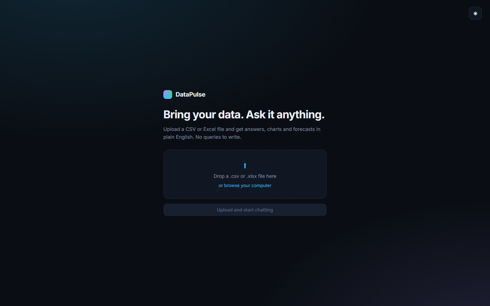
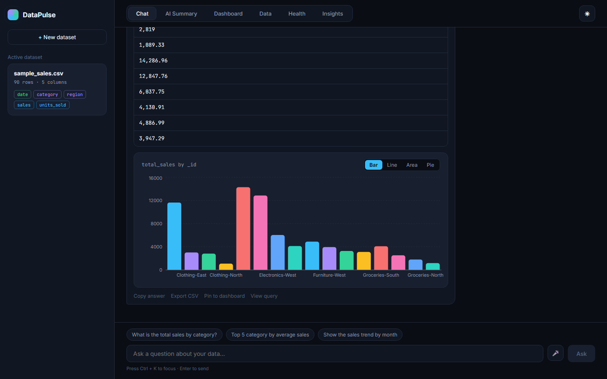
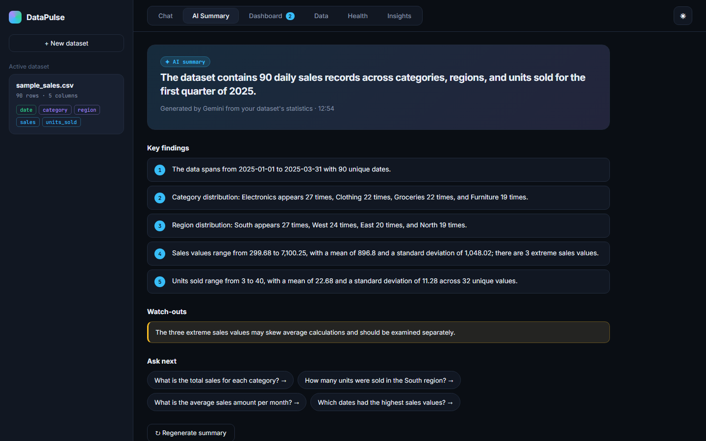
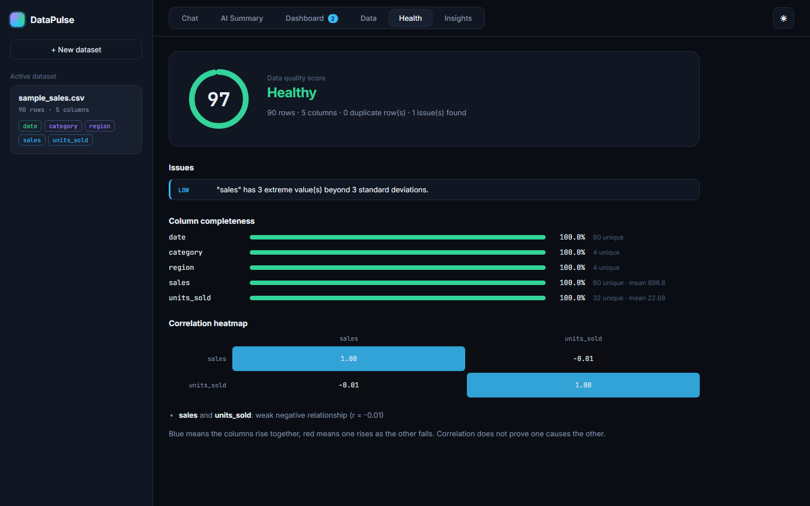
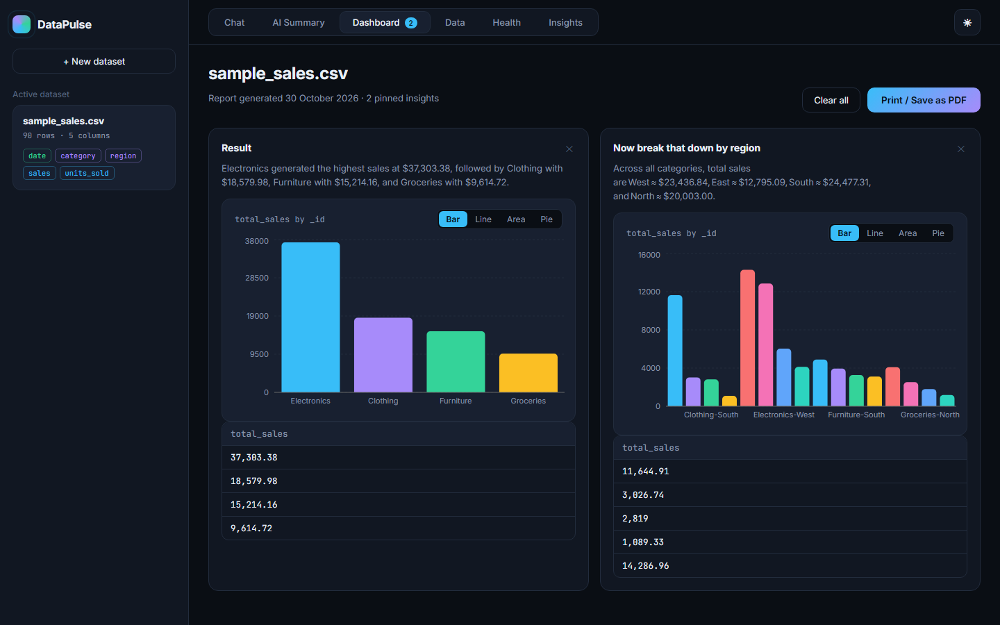
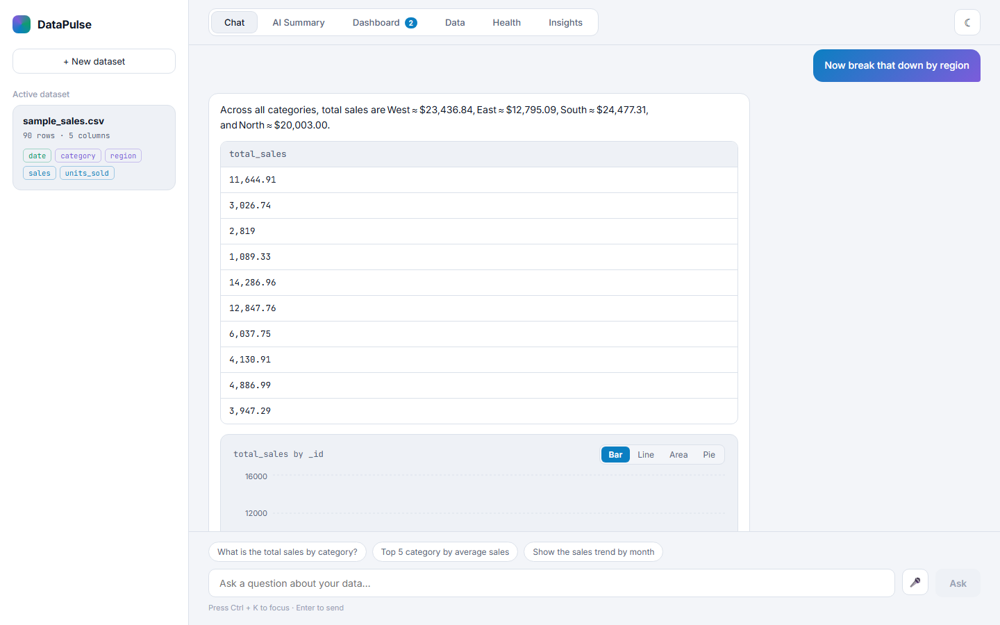
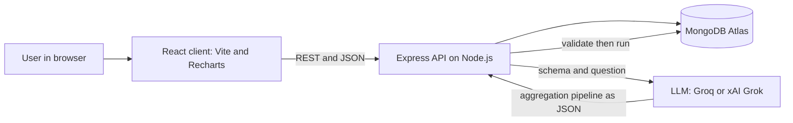

# DataPulse

### An AI-powered chatbot for data exploration and insights

Upload a CSV or Excel file, then ask questions about it in plain English. DataPulse writes the database query for you, runs it safely, and answers with a summary, a table and a chart. It also profiles your data, flags quality problems, detects outliers and forecasts trends.


**Live demo:** https://data-pulse-green.vercel.app
*(The backend runs on a free tier and sleeps when idle, so the first request can take about a minute.)*

---

## Table of contents

- [Screenshots](#screenshots)
- [Features](#features)
- [How it works](#how-it-works)
- [Tech stack](#tech-stack)
- [Project structure](#project-structure)
- [Getting started](#getting-started)
- [Environment variables](#environment-variables)
- [API reference](#api-reference)
- [Safety and privacy](#safety-and-privacy)
- [Deployment](#deployment)
- [Development tools](#development-tools)
- [Troubleshooting](#troubleshooting)
- [Limitations](#limitations)
- [Roadmap](#roadmap)
- [Author](#author)

---

## Screenshots

<p align="center">
  
  
</p>
<p align="center">
  
  
</p>
<p align="center">
  
  
</p>

---

## Features

### Ask your data anything
- **Natural-language questions.** Type "What is the total sales by category?" and get an answer, a table and a chart.
- **Follow-up memory.** The last three exchanges are remembered, so "now break that down by region" works.
- **Transparent answers.** Every answer has a **View query** button that shows the exact MongoDB pipeline that was run.
- **Chart switcher.** Flip any result between bar, line, area and pie.
- **Suggested questions.** Starter questions are generated from your dataset's own columns.
- **Voice input and shortcuts.** Dictate a question with the mic button, or press `Ctrl + K` to focus the input.
- **Export and copy.** Download any result as CSV or copy the answer text.

### Understand your dataset
- **AI Summary.** A written briefing with a headline, key findings, watch-outs and four suggested questions. Click a question and it jumps to Chat and asks it.
- **Data Health report.** A 0 to 100 quality score based on missing values, duplicate rows, constant columns and extreme values. It lists issues by severity and shows per-column completeness.
- **Correlation heatmap.** See which numeric columns move together, with a plain-English summary of the strongest relationships.
- **Data tab.** Column types with sample values, plus a preview of the first rows.

### Predictive insights
- **Outlier detection** using z-scores, with an adjustable sensitivity slider.
- **Trend forecasting** using linear regression, drawn as actual values (solid line) and projected values (dashed line).

### Built to present
- **Pinned dashboard.** Pin any chart from the chat into a dashboard, then print it or save it as a PDF report.
- **Dataset history.** Reopen earlier datasets and their chat history from the sidebar.
- **Light and dark themes**, remembered between visits.

---

## How it works



When you ask a question:

1. The client sends the question and dataset ID to the API.
2. The server loads the dataset's **schema** (column names, types and a few sample values) and the last three successful exchanges.
3. The LLM returns a **MongoDB aggregation pipeline** as JSON.
4. A **safety validator** rejects any pipeline that uses a write or code-execution stage.
5. The pipeline runs against that dataset's own collection in MongoDB.
6. The LLM writes a one or two sentence plain-English answer from the first 20 result rows.
7. The client shows the answer, a table and an automatically chosen chart.

Each uploaded file is stored in its own MongoDB collection, with a `Dataset` document that holds its schema and row count.

---

## Tech stack

| Layer | Technology |
|---|---|
| Frontend | React, Vite, Recharts, Axios |
| Backend | Node.js, Express (ES modules), Mongoose |
| Database | MongoDB Atlas |
| File parsing | Multer, csv-parser, SheetJS (xlsx) |
| AI | Any OpenAI-compatible chat API. Groq is the default and xAI Grok is supported. |
| Hosting | Vercel (frontend), Render (backend) |

---

## Project structure

```
DataPulse/
├── client/
│   ├── public/favicon.svg
│   ├── src/
│   │   ├── components/
│   │   │   ├── AutoInsights.jsx     # AI Summary tab
│   │   │   ├── ChatWindow.jsx       # chat, suggestions, voice, pin
│   │   │   ├── Dashboard.jsx        # pinned charts, print to PDF
│   │   │   ├── DataPreview.jsx      # column profile and sample rows
│   │   │   ├── DatasetUpload.jsx    # drag-and-drop upload
│   │   │   ├── HealthReport.jsx     # quality score and heatmap
│   │   │   ├── InsightsPanel.jsx    # outliers and forecast
│   │   │   └── ResultChart.jsx      # bar, line, area and pie charts
│   │   ├── services/api.js          # all backend calls
│   │   ├── App.jsx  App.css  main.jsx  usePins.js  utils.js
│   ├── index.html  vercel.json  .env.example
├── server/
│   ├── src/
│   │   ├── config/db.js
│   │   ├── controllers/             # dataset, chat, insights, health, autoInsights
│   │   ├── middleware/upload.js
│   │   ├── models/                  # Dataset, ChatMessage
│   │   ├── routes/                  # dataset, chat, insights
│   │   ├── services/
│   │   │   ├── chatService.js       # LLM calls, pipeline safety, chat memory
│   │   │   ├── healthService.js     # quality score and correlations
│   │   │   ├── mlInsightsService.js # outliers and forecasting
│   │   │   └── profileService.js    # statistics sent to the AI summary
│   │   ├── utils/fileParser.js      # CSV/Excel parsing and type inference
│   │   ├── app.js  server.js
│   └── .env.example
├── sample-data/sample_sales.csv     # demo dataset with a trend and 3 outliers
├── tools/                           # screenshot and sample-data scripts
├── docs/screenshots/
└── README.md
```

---

## Getting started

### Prerequisites

- Node.js 20 or newer (22 recommended)
- A free [MongoDB Atlas](https://www.mongodb.com/cloud/atlas) cluster
- An API key from [Groq](https://console.groq.com/keys) (free tier) or [xAI](https://console.x.ai)

### 1. Clone the repository

```bash
git clone https://github.com/MohdAdil-02/DataPulse.git
cd DataPulse
```

### 2. Start the backend

```bash
cd server
npm install
cp .env.example .env        # on Windows PowerShell: copy .env.example .env
```

Open `server/.env` and fill in your values (see [Environment variables](#environment-variables)), then:

```bash
npm run dev
```

You should see `[db] MongoDB connected` and `[server] Listening on http://localhost:5000`.

### 3. Start the frontend

In a second terminal:

```bash
cd client
npm install
cp .env.example .env        # on Windows PowerShell: copy .env.example .env
npm run dev
```

Open http://localhost:5173.

### 4. Try it

Upload `sample-data/sample_sales.csv` (90 rows with a rising trend and three planted outliers), then try:

- "What is the total sales by category?"
- "Now break that down by region"
- "Show the sales trend by month"
- Open the **AI Summary**, **Health** and **Insights** tabs, then pin a few answers and open the **Dashboard**.

---

## Environment variables

### `server/.env`

| Variable | Required | Description |
|---|---|---|
| `PORT` | No | Server port. Defaults to `5000`. |
| `MONGODB_URI` | Yes | Your Atlas connection string. Include the database name, for example `.../chatbot_data_exploration?retryWrites=true&w=majority`. |
| `AI_PROVIDER` | No | `groq` (default) or `xai`. |
| `GROQ_API_KEY` | If using Groq | Key that starts with `gsk_`. |
| `XAI_API_KEY` | If using xAI | Key that starts with `xai-`. |
| `AI_MODEL` | No | Overrides the default model. The Groq default is `openai/gpt-oss-120b`. Providers retire models often, so check your provider's console if you get a "model not found" error. |
| `CLIENT_ORIGIN` | Yes in production | Allowed frontend address. Accepts several, separated by commas, for example `http://localhost:5173,https://your-app.vercel.app`. Trailing slashes are ignored. |
| `DNS_SERVERS` | No | For networks that block MongoDB SRV lookups, set `8.8.8.8,1.1.1.1`. |

### `client/.env`

| Variable | Description |
|---|---|
| `VITE_API_URL` | Backend address, for example `http://localhost:5000` or `https://your-api.onrender.com`. The `/api` suffix is added automatically. |

> Never commit `.env` files. They are listed in `.gitignore`. Only the `.env.example` files are tracked.

---

## API reference

All routes are also available without the `/api` prefix.

| Method | Endpoint | Description |
|---|---|---|
| GET | `/api/health` | Server status check |
| POST | `/api/datasets/upload` | Upload a CSV or Excel file (multipart field `file`, max 20 MB) |
| GET | `/api/datasets` | List uploaded datasets |
| GET | `/api/datasets/:id` | One dataset's metadata |
| GET | `/api/datasets/:id/preview` | First 10 rows |
| POST | `/api/chat/ask` | Body `{ datasetId, question }`. Returns the answer, pipeline and result. |
| GET | `/api/chat/:datasetId/history` | Saved chat messages |
| GET | `/api/insights/:datasetId/columns` | Numeric and date columns |
| GET | `/api/insights/:datasetId/outliers` | Query `column`, optional `threshold` |
| GET | `/api/insights/:datasetId/forecast` | Query `dateColumn`, `valueColumn`, optional `periods` |
| GET | `/api/insights/:datasetId/health` | Data quality report |
| GET | `/api/insights/:datasetId/correlations` | Correlation matrix (first 12 numeric columns) |
| GET | `/api/insights/:datasetId/summary` | AI summary. Add `?refresh=1` to regenerate. |

---

## Safety and privacy

- **Query validation.** Every AI-generated pipeline is checked before it runs. Pipelines containing `$out`, `$merge`, `$function`, `$accumulator`, `$where` or `$lookup` are rejected, so the AI cannot write data, run code or read other collections.
- **Transparency.** The generated query is always viewable, so answers can be verified rather than trusted.
- **What the AI sees.** Your full dataset is never sent to the AI provider. It receives the schema, a few sample values per column, aggregate statistics (for the summary), your question, recent chat turns, and the first 20 rows of a query result.
- **Secrets stay on the server.** API keys are read from server environment variables and are never shipped to the browser.
- **Temporary files.** Uploaded files are deleted from disk as soon as they are parsed. The data lives only in your MongoDB database.
- **CORS allow-list.** The API only accepts requests from the origins in `CLIENT_ORIGIN`.
- **No user separation yet.** There are no accounts, so every dataset in the database is visible to every visitor. Do not upload sensitive data to a public deployment. See [Limitations](#limitations).

---

## Deployment

### Backend on Render

| Setting | Value |
|---|---|
| Root Directory | `server` |
| Build Command | `npm install` |
| Start Command | `npm start` |
| Health Check Path | `/api/health` |

Environment variables: `MONGODB_URI`, `AI_PROVIDER`, the matching API key, `AI_MODEL`, `CLIENT_ORIGIN` (your Vercel address) and `NODE_VERSION=22`.

In MongoDB Atlas, open **Network Access** and allow `0.0.0.0/0`, because Render's IP addresses change.

### Frontend on Vercel

| Setting | Value |
|---|---|
| Root Directory | `client` |
| Framework Preset | Vite |
| Build Command | `npm run build` |
| Output Directory | `dist` |

Environment variable: `VITE_API_URL` set to your Render address. Vite reads it at build time, so redeploy after changing it. `client/vercel.json` pins the build settings.

Both platforms redeploy automatically on every push to `main`.

---

## Development tools

The `tools/` folder holds two helper scripts. Run them from the project root.

```bash
# Create sample-data/sample_sales.csv (90 rows, rising trend, 3 planted outliers)
node tools/make-sample.mjs

# Capture the README screenshots from the live site (needs Playwright, see below)
node tools/screenshots.mjs
```

One-time setup for the screenshot script:

```bash
cd tools
npm init -y
npm install playwright
npx playwright install chromium
cd ..
```

The script wakes the backend, uploads the sample file, asks two questions, pins them, visits every tab, and saves six images to `docs/screenshots/`. If it fails, it saves `_error.png` showing where it stopped.

---

## Troubleshooting

| Problem | Fix |
|---|---|
| `querySrv ECONNREFUSED` when the server starts | Your network blocks MongoDB SRV lookups. Add `DNS_SERVERS=8.8.8.8,1.1.1.1` to `server/.env`. |
| `Invalid scheme, expected connection string to start with "mongodb://"` | `MONGODB_URI` is empty or still a placeholder. Paste your real Atlas string without quotes. |
| `model_not_found` from the AI provider | The model was retired or isn't available to your account. Set `AI_MODEL` to a current model from your provider's console. |
| "rate limit reached" | You hit the free-tier limit. Wait a minute, or switch to a lighter model. |
| CORS error in the browser | `CLIENT_ORIGIN` doesn't match the site's address. Check `https`, the spelling and quotes, then redeploy the backend. |
| `404` on every request from the live site | `VITE_API_URL` is wrong, or the frontend wasn't rebuilt after changing it. |
| Vercel runs `npm run dev` and never finishes | Set the Build Command to `npm run build` and the Output Directory to `dist`, or keep `client/vercel.json`. |
| First request after a while is very slow | The free backend was asleep. Wait about a minute. |
| A new `.env` value has no effect | Restart the server. Nodemon does not watch `.env`. |
| `does not provide an export named ...` in the browser | A client file is out of date. Compare `client/src/services/api.js` with the repo version. |

---

## Limitations

- **There is no login.** Anyone with the link can upload data, see every dataset in the database, and use your AI quota. Do not upload sensitive data to a public deployment.
- AI-generated queries can be wrong. Use **View query** to check anything important.
- Health, correlation and insight calculations use up to 50,000 rows per dataset.
- Forecasting is a simple linear trend. Treat it as a direction indicator, not a precise prediction.
- Pinned dashboard items are stored in your browser, so they don't follow you to another device.
- Uploads are limited to 20 MB and the first sheet of an Excel file.
- AI summaries are cached in server memory and reset when the server restarts.
- On free hosting the backend sleeps after a period without traffic.

---

## Roadmap

- User accounts and per-user datasets (JWT), so each person only sees their own data
- Delete datasets and clear chat history
- Rate limiting and usage quotas
- Better time-series models such as seasonal forecasting
- Export the dashboard as an image
- Connect directly to external databases

---

## Author

**[Your Name]** | [Your Roll No.] | B.Tech, [Your Branch]
Lloyd Institute of Engineering & Technology, AKTU
Guide: [Guide's Name]

GitHub: [@MohdAdil-02](https://github.com/MohdAdil-02)

*Built as a B.Tech major project: "AI-Based Chatbot for Data Exploration and Insights".*